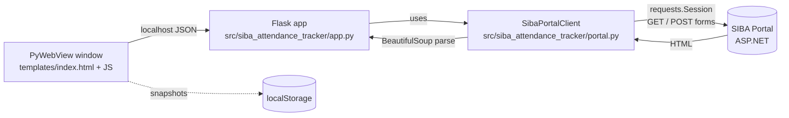

# SIBA Attendance Tracker — Technical Documentation

This document explains how the project is built, how data flows through it, and how to run, extend, and test it. For a quick overview, see the [README](../README.md).

## Table of Contents

1. [Overview](#1-overview)
2. [Architecture](#2-architecture)
3. [How the Portal Integration Works](#3-how-the-portal-integration-works)
4. [Module Reference](#4-module-reference)
5. [API Reference](#5-api-reference)
6. [Frontend](#6-frontend)
7. [Data Models](#7-data-models)
8. [Testing](#8-testing)
9. [Security Considerations](#9-security-considerations)
10. [Troubleshooting](#10-troubleshooting)
11. [Extending the Project](#11-extending-the-project)

---

## 1. Overview

The SIBA student portal is an ASP.NET WebForms site. It shows attendance one subject at a time, behind a login, and presents raw lists of dates rather than a summary.

**SIBA Attendance Tracker** is a small desktop app that acts as a friendly
layer on top of that portal:

1. The user logs in through the tracker's own page.
2. The Flask backend logs in to the portal on the user's behalf and keeps that portal session.
3. When attendance is requested, the backend submits the portal's forms, parses the returned HTML, and computes totals and percentages.
4. The embedded dashboard shows the result as cards with progress bars, and
   can save snapshots locally.

There is no database. The only persistent data is the optional snapshot kept in the browser's `localStorage`.

---

## 2. Architecture



### Components

| Component | File | Responsibility |
|-----------|------|----------------|
| Web server and API | `src/siba_attendance_tracker/app.py` | Routes, session cookie, error-to-HTTP mapping, shaping JSON for the UI |
| Portal client | `src/siba_attendance_tracker/portal.py` → `SibaPortalClient` | Logs in, submits ASP.NET postbacks, keeps cookies and the latest page |
| Parsers | `src/siba_attendance_tracker/portal.py` → `parse_attendance_html`, `parse_portal_options` | Turn portal HTML into Python dictionaries |
| UI | `src/siba_attendance_tracker/templates/index.html` | Three views (Live, Saved, Login) and all client-side logic |
| Styling | `src/siba_attendance_tracker/static/style.css` | Dark theme, cards, progress bars, absence boxes |

### Session model

Each successful login creates one `SibaPortalClient` (which owns a `requests.Session` with the portal's cookies). The client is stored in a module-level dictionary in `app.py`:

```python
clients: dict[str, SibaPortalClient] = {}
```

A random `client_id` is generated with `secrets.token_urlsafe(24)`, stored in Flask's signed session cookie, and used to look the client up on later requests. Logging out removes the entry.

---

## 3. How the Portal Integration Works

ASP.NET WebForms pages keep their state in hidden form fields (`__VIEWSTATE`, `__EVENTVALIDATION`, and so on) and use *postbacks* to react to dropdown changes and button clicks. To work with it, the client has to behave like a browser submitting the form.

### 3.1 Login

1. `GET Default.aspx` to fetch the login page.
2. Collect every hidden input inside `form#form1` (`_hidden_fields`).
3. `POST` those fields plus `txtuid` (CMS ID), `txtpwd` (password), and `Button1=Login`.
4. If the response still contains an `input[name=txtuid]`, the login failed. The message from element `#Label1` (if present) is surfaced to the user.
5. On success, `GET wpAttendance.aspx` and keep its HTML as the current page.

### 3.2 Changing the semester

Selecting a semester triggers an ASP.NET postback. `select_semester()` posts the current hidden fields with:

| Field | Value |
|-------|-------|
| `__EVENTTARGET` | `ctl00$ContentPlaceHolder1$Dpsemester` |
| `__EVENTARGUMENT` | empty |
| `ctl00$ContentPlaceHolder1$Dpsemester` | chosen semester value |
| `ctl00$ContentPlaceHolder1$DpCmscourses` | currently selected subject value |

The response contains the **subject list for that semester**, which is parsed and returned.

### 3.3 Fetching attendance

`attendance()` posts the hidden fields, the chosen semester and subject, and the submit button value `ctl00$ContentPlaceHolder1$Button1 = "CMS CLASS ATTENDANCE"`. The returned page contains the attendance grid.

### 3.4 Parsing the attendance table

`parse_attendance_html()`:

1. Reads the selected semester and subject from the two `<select>` elements.
2. Finds the table whose `id` contains `RadGrid1_ctl00` (Telerik's generated grid ID).
3. Validates that the header row contains the expected columns: `s.no`, `attendacne date`, `from time`, `present`, `class minutes`. (The misspelling "attendacne" is the portal's own, and the parser matches it exactly.)
4. Iterates over body rows, keeps rows whose status is `Present` or `Absent`, and skips anything else (pager rows, empty rows).
5. Converts minutes into the portal's attendance values and builds the summary.

### 3.5 Fetching a semester snapshot

`all_attendance(semester_value=...)` loads the selected semester's subjects and calls
`attendance()` for each subject. This makes one portal request per subject plus one
for the semester selection.

---

## 4. Module Reference

### `src/siba_attendance_tracker/portal.py`

**Constants**

| Name | Value | Meaning |
|------|-------|---------|
| `LOGIN_PATH` | `Default.aspx` | Portal login page |
| `ATTENDANCE_PATH` | `wpAttendance.aspx` | Portal attendance page |
| `SEMESTER_FIELD` | `ctl00$ContentPlaceHolder1$Dpsemester` | Semester dropdown name |
| `COURSE_FIELD` | `ctl00$ContentPlaceHolder1$DpCmscourses` | Subject dropdown name |
| `ATTENDANCE_SUBMIT_FIELD` | `ctl00$ContentPlaceHolder1$Button1` | Attendance submit button |
| `MINUTES_PER_UNIT` | `50` | Length of one class unit |
| `ALLOWED_ABSENCE_UNITS` | `12` | Absence units allowed per subject |

**Exceptions**

| Class | Raised when | HTTP status in API |
|-------|-------------|--------------------|
| `PortalError` | Base class; network failure | `502` |
| `PortalLoginError` | Bad credentials, or not logged in | `401` |
| `PortalResponseError` | Portal returned an unexpected page | `502` |

**Functions**

| Function | Purpose |
|----------|---------|
| `_hidden_fields(soup)` | Returns all hidden inputs of `form#form1` as a dict |
| `_options(soup, field_name)` | Returns `[{name, value, selected}]` for a `<select>` |
| `parse_attendance_html(html)` | Parses an attendance page into records and a summary |
| `parse_portal_options(html)` | Returns semester and subject options; raises `PortalLoginError` if the page is the login form |

**`SibaPortalClient`** (dataclass with `base_url` and `timeout`)

| Method | Purpose |
|--------|---------|
| `login(username, password)` | Authenticates and loads the attendance page |
| `options()` | Semester and subject options for the current page |
| `select_semester(semester)` | Performs the semester postback and returns refreshed options |
| `attendance(semester=None, subject=None)` | Returns the parsed attendance for the selection (or current page if none given) |
| `all_attendance(semester_value=None)` | Returns summaries for every subject in the selected semester, or all semesters when called without a filter |

### `src/siba_attendance_tracker/app.py`

| Item | Purpose |
|------|---------|
| `_client()` | Looks up the logged-in client for the current cookie, or raises `PortalLoginError` |
| `_error_response(error)` | Maps `PortalLoginError` → 401, other `PortalError` → 502 |
| Route handlers | See the [API reference](#5-api-reference) |

---

## 5. API Reference

All endpoints return JSON except `/`, which serves the HTML page. Errors have the shape:

```json
{ "error": "Human readable message" }
```

### `POST /api/login`

Logs in to the portal and starts a session.

**Body** (JSON, or form data)

```json
{ "username": "your-cms-id", "password": "your-password" }
```

**Responses**

| Status | Body |
|--------|------|
| `200` | `{ "message": "Logged in to SIBA." }` |
| `401` | `{ "error": "CMS ID and password are required." }` or the portal's own rejection message |
| `502` | `{ "error": "Could not reach the SIBA portal." }` |

### `POST /api/logout`

Removes the server-side client and clears the session entry.

**Response:** `200 { "message": "Logged out." }`

### `GET /api/attendance/options`

Returns the semesters and subjects available.

| Query param | Required | Description |
|-------------|----------|-------------|
| `semester` | no | If given, performs the semester postback first so `subjects` reflects that semester |

**Response `200`**

```json
{
  "semesters": [
    { "name": "Fall 2026", "value": "2613", "selected": true }
  ],
  "subjects": [
    { "name": "Linear Algebra", "value": "1328", "selected": true }
  ]
}
```

### `GET /api/attendance`

Compact summary for **one subject**, returned as a one-item list.

| Query param | Required | Description |
|-------------|----------|-------------|
| `semester` | no | Semester value |
| `subject` | no | Subject value |

**Response `200`**

```json
[
  {
    "subject": "Linear Algebra",
    "attended": 17.2,
    "absent": 7.0,
    "total": 24.2,
    "attended_units": 17.2,
    "absent_units": 7.0,
    "total_units": 24.2,
    "absence_boxes_used": 7,
    "allowed_absence_units": 12
  }
]
```

### `GET /api/attendance/details`

Same query params as above. Returns the full parsed result, including every class record. This is what the Live Attendance view uses.

**Response `200`**

```json
{
  "semester": { "name": "Fall 2026", "value": "2613" },
  "subject":  { "name": "Linear Algebra", "value": "1328" },
  "records": [
    { "number": "1", "date": "16-OCT-2026", "time": "09:00",
      "status": "Present", "minutes": 100 }
  ],
  "summary": {
    "present": 1, "absent": 1, "total": 2,
    "present_units": 2.0, "absent_units": 1.0, "total_units": 3.0,
    "allowed_absence_units": 12,
    "absence_boxes_used": 1,
    "percentage": 66.67
  }
}
```

### `GET /api/attendance/snapshot`

Fetches a summary for **every subject** in the selected semester.

| Query param | Required | Description |
|-------------|----------|-------------|
| `semester` | yes | The semester to save. An **empty** value (`?semester=`) returns `400`. |

**Response `200`** — a list, one entry per subject:

```json
[
  {
    "semester": { "name": "Fall 2026", "value": "2613" },
    "subject":  { "name": "Linear Algebra", "value": "1328" },
    "attended": 17.2, "absent": 7.0, "total": 24.2,
    "attended_units": 17.2, "absent_units": 7.0, "total_units": 24.2,
    "absence_boxes_used": 7,
    "allowed_absence_units": 12,
    "percentage": 71.07
  }
]
```

| Status | Meaning |
|--------|---------|
| `400` | Empty `semester` parameter |
| `401` | Not logged in |
| `502` | Portal unreachable or returned invalid data |

> All attendance endpoints return `401` with `"Log in to SIBA before requesting attendance."` when there is no active session.

---

## 6. Frontend

The UI is a single page (`templates/index.html`) with three views, switched by the sidebar without reloading the page.

| View | Purpose |
|------|---------|
| **Live Attendance** | Semester and subject dropdowns, a **Refresh attendance** button, and an attendance card |
| **Saved Attendance** | Shows the one locally saved semester snapshot and provides a clear button |
| **Portal Login** | CMS ID and password form |

### Attendance card

Each card shows:

- Subject name
- `X present out of Y`
- Rounded percentage and a progress bar
- `N absent out of 12`, with 12 boxes (used boxes are filled)

### Snapshots in `localStorage`

Snapshots are stored under the key `siba-attendance-snapshot`:

```json
{
  "savedAt": "2026-10-16T18:30:00.000Z",
  "semester": { "name": "Fall 2026", "value": "2613" },
  "records": [ /* one entry per subject, as returned by /snapshot */ ]
}
```

- **Save semester** replaces the existing snapshot.
- **Clear saved attendance** removes the snapshot after confirmation.
- Snapshots are per browser and per device. Clearing site data removes them.

### Safe rendering

Cards are built with `createElement` and `textContent` rather than `innerHTML`, so portal text can never inject markup into the page.

---

## 7. Data Models

**Record** (one class session)

| Field | Type | Example |
|-------|------|---------|
| `number` | string | `"1"` |
| `date` | string | `"16-OCT-2026"` |
| `time` | string | `"09:00"` |
| `status` | `"Present"` or `"Absent"` | `"Present"` |
| `minutes` | int or `null` | `100` |

**Summary**

| Field | Meaning |
|-------|---------|
| `present`, `absent`, `total` | Count of **sessions** |
| `present_units`, `absent_units`, `total_units` | Same, measured in 50-minute **units** |
| `allowed_absence_units` | 12 |
| `absence_boxes_used` | `ceil(absent_units)` |
| `percentage` | `present_units / total_units × 100`, rounded to 2 decimals (0 if no classes) |

---

## 8. Testing

### Running

```bash
python -m unittest test_backend -v   # client + API route tests
PYTHONPATH=src python -m unittest discover -s tests -v
```

### What is covered

| Test | Verifies |
|------|----------|
| `tests/test_parser.py` | Parsing a minimal hand-written page: names, counts, units, percentage |
| `test_login_loads_options_and_attendance` | Login posts credentials, options and summary are parsed correctly |
| `test_attendance_selection_posts_aspnet_form` | Semester, subject, and submit button are posted |
| `test_semester_change_posts_aspnet_event_and_refreshes_options` | `__EVENTTARGET` postback is sent |
| `test_all_attendance_returns_snapshot_records` | Snapshot walks all semesters and subjects |
| `test_all_attendance_can_limit_to_one_semester` | Semester filter works |
| `test_snapshot_route_passes_selected_semester` | Route forwards the `semester` argument |
| `test_snapshot_route_rejects_empty_semester` | Empty value returns `400` |

The backend tests replace `requests.Session` with a `FakeSession`, so **no real network calls are made**.

### The `actual_attendance.html` fixture

`tests/test_backend.py` loads `actual_attendance.html`, a saved copy of a real portal page. Because a real page can contain personal details, the file is excluded by `.gitignore`. That means **the backend tests will fail on a fresh clone** until a fixture exists.

Two ways to handle that:

1. **Create your own sanitized fixture.** Save an attendance page from the portal, remove names, IDs, and any other personal data, and save it as `actual_attendance.html`. The test numbers (for example 70 records across all semesters) match the original page, so you would also need to adjust the assertions to match your file.
2. **Build a small synthetic fixture** with the same structure as `test_parser.py`'s sample (two selects and a `RadGrid1_ctl00` table), and update the expected values in the tests.

Option 2 is the better choice if you want contributors to be able to run the tests.

---

## 9. Security Considerations

| Topic | Current behavior | Recommendation |
|-------|------------------|----------------|
| Credentials | Forwarded to the portal, never stored or logged | Keep it that way |
| Transport to portal | The portal uses plain HTTP | Use only on trusted networks; use HTTPS if the university adds it |
| Session cookie | Signed with `SECRET_KEY` | Set `FLASK_SECRET_KEY` to a long random value |
| Secret key | Random on every start, so a restart logs everyone out | Fix the value via env var if you want persistence |
| Session storage | In-memory dict, no expiry | Add expiry and cleanup before any multi-user use |
| Debug mode | Disabled | Keep it disabled in release builds |
| Exposure | Intended for `127.0.0.1` | Do not deploy publicly with the current design |
| Data in browser | Snapshots in `localStorage` | Contains attendance data only, no credentials |

The release is intended for one local user. Do not expose the embedded API to
the network or reuse this session design as a multi-user hosted service.

---

## 10. Troubleshooting

| Symptom | Likely cause | Fix |
|---------|--------------|-----|
| "Could not reach the SIBA portal." | Portal down, or your network cannot reach port 86 | Open the portal URL in a browser; try another network |
| "SIBA rejected the credentials." | Wrong CMS ID or password | Check them on the official portal |
| "Log in to SIBA before requesting attendance." | No session, or the server restarted | Log in again from **Portal Login** |
| "SIBA returned an unexpected attendance page." | Portal layout changed, or the session expired on the portal side | Log in again; if it persists, the parser needs updating |
| "Unexpected attendance table columns: …" | Portal renamed a column | Update `required_headers` in `parse_attendance_html` |
| Semester dropdown is empty | Not logged in yet | Log in first |
| "Save all semesters" is slow | One request per subject | Wait, or save a single semester |
| Backend tests fail with `FileNotFoundError` | `actual_attendance.html` is git-ignored | See [Testing](#the-actual_attendancehtml-fixture) |

---

## 11. Extending the Project

**Change the absence rule or unit length**
Edit `ALLOWED_ABSENCE_UNITS` and `MINUTES_PER_UNIT` at the top of `src/siba_attendance_tracker/portal.py`. The UI reads `allowed_absence_units` from the API, so the boxes adjust automatically.

**Add a "classes I can still skip" calculator**
All the numbers are already in the summary. For a required percentage `r` (for example `0.75`) and current units `p` present and `t` total, the number of extra 1-unit absences you can take while staying at or above `r`, assuming no more classes are attended, is `floor(p / r − t)` when positive. Add it in `parse_attendance_html` or in the frontend.

**Show per-class history**
`/api/attendance/details` already returns `records`. Render them as a table under the card in `index.html`.

**Export to CSV**
Add a button in the Saved view that converts the `localStorage` snapshot into CSV and downloads it using a `Blob`.

**Build a desktop release**
Install `desktop-requirements.txt` and run the PyInstaller command documented
in the README. Build separately on Linux and Windows.
